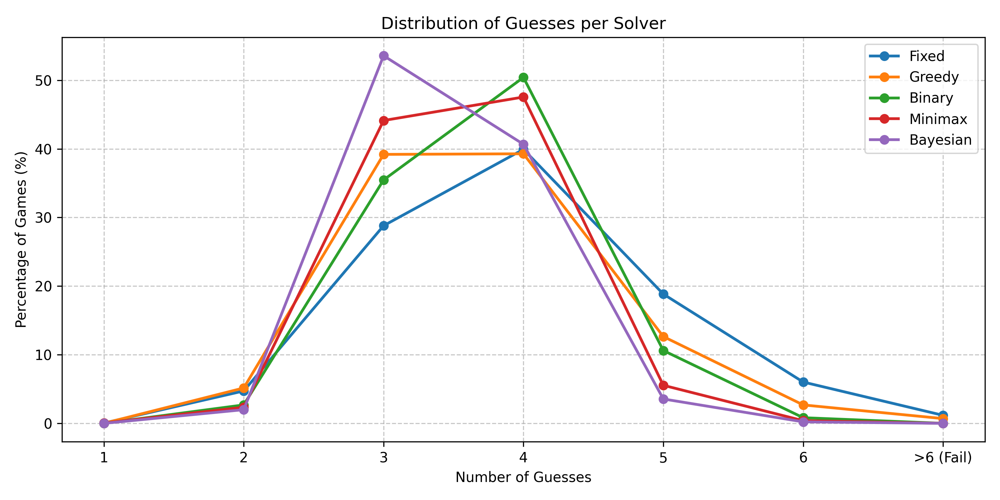

# Wordle Solver

A Wordle assistant with a static browser interface, a Python Tkinter interface, an interactive command-line game, and several algorithms for choosing guesses. The website uses only the precomputed JSON decision trees; the Python solver can calculate guesses and save new branches.

## Requirements

- Python 3.12 or later
- Tkinter, typically included with Python
- `matplotlib` and `tqdm` only for running the solver comparison

No third-party packages are required for the GUI, command-line game, or interactive solver.

Run the commands below from the repository root so the application can find the word lists and decision-tree files.

## Run the app

### Website

The static website in `web\` runs in a browser and uses only the precomputed JSON decision trees in `trees\`. It does not run Python, access the word lists, or calculate new guesses. If a feedback path is missing from the selected tree, the website reports that no saved branch is available.

From the repository root, start a local web server:

```powershell
py -m http.server 8000
```

Then open <http://localhost:8000/web/>. The server is needed because browsers do not allow the website to fetch its JSON tree files when `index.html` is opened directly from disk. The same `web\` folder can be hosted on a static web host alongside `trees\`.

Select a decision tree and click **Start game**. For each guess, click each tile to cycle through gray, yellow, and green, then submit the feedback.

### Desktop GUI

Launch the GUI:

```powershell
py -m app.wordle_solver
```

Choose a solver and select **Start Game**. Enter its guess in Wordle, then click each letter tile until its color matches the feedback:

- Green: correct letter in the correct position
- Yellow: correct letter in the wrong position
- Gray: letter is not in the answer

Tiles cycle green → yellow → gray. Select **Submit Feedback** to get the next guess. The **Pre-Trained Solver** option uses the matching JSON decision tree in `trees\` when available; missing branches are calculated and saved as you play. Turn it off to calculate guesses directly. The `Fixed` solver does not use a decision tree.

## Command-line tools

Play a local Wordle game with a randomly selected answer:

```powershell
py -m core.game
```

Try a solver interactively by entering the feedback for each guess as five digits (`0` = gray, `1` = yellow, `2` = green):

```powershell
py -m core.solvers
```

The solver comparison evaluates the configured solvers against the answer list, prints summary statistics, and creates `wordle_solver_comparison.png`:

```powershell
py -m app.summary
```

The comparison uses `matplotlib` and `tqdm`. Install them if needed:

```powershell
py -m pip install matplotlib tqdm
```

## Solvers

| Solver | Strategy |
| --- | --- |
| `Entropy` | Chooses guesses with high expected information gain (entropy), considering all allowed guesses until only a few answers remain. |
| `NaiveEntropy` | Chooses the allowed guess with the highest expected information gain across all candidate counts. |
| `BiasedEntropy` | Uses entropy scoring with a small bonus for guesses that are possible answers. |
| `LookaheadEntropy` | Uses a two-step lookahead for smaller candidate sets and one-step entropy scoring for larger sets. |
| `Minimax` | Chooses a guess that minimizes the largest possible remaining answer group, considering only answers when few candidates remain. |
| `NaiveMinimax` | Chooses the allowed guess that minimizes the largest possible remaining answer group. |
| `BinarySplit` | Scores guesses by how effectively their distinct letters divide the remaining answers into similarly sized groups. |
| `PositionalFreq` | Scores guesses by the positional frequency of letters among remaining answers, prioritizing unresolved positions. |
| `FixedIndex` | Selects an answer at a fixed position in the remaining list. |

Solvers filter the possible answers after each piece of feedback. Solvers that consider all allowed words as guesses can use words outside the remaining answer candidates; `Entropy` and `Minimax` switch to remaining answers when only a few candidates remain.

## Performance analysis

The chart shows the distribution of guesses per game for each solver. Games requiring more than six guesses are counted as failures.



| Solver | Fail Rate | Avg Guesses | Avg Guesses (Solved Games) |
| --- | ---: | ---: | ---: |
| FixedIndex | 1.65% | 3.9796 | 3.9238 |
| PositionalFreq | 1.04% | 3.7202 | 3.6818 |
| BinarySplit | 0.00% | 3.7142 | 3.7142 |
| NaiveMinimax | 0.00% | 3.6769 | 3.6769 |
| Minimax | 0.00% | 3.5738 | 3.5738 |
| NaiveEntropy | 0.00% | 3.5275 | 3.5275 |
| Entropy | 0.00% | 3.4643 | 3.4643 |
| BiasedEntropy | 0.00% | 3.4638 | 3.4638 |
| LookaheadEntropy | 0.00% | 3.4604 | 3.4604 |

LookaheadEntropy had the lowest average at 3.4604 guesses, with no failures; BiasedEntropy and Entropy were close behind at 3.4638 and 3.4643. FixedIndex had the highest average and failure rate among the compared solvers.

## Repository layout

| Path | Contents |
| --- | --- |
| `app\wordle_solver.py` | Tkinter Wordle assistant |
| `app\summary.py` | Solver evaluation and comparison chart |
| `web\` | Static, browser-based assistant that traverses saved decision trees |
| `core\game.py` | Word lists, feedback encoding, and command-line game |
| `core\solvers.py` | Solver algorithms and interactive solver |
| `core\decision_tree.py` | JSON decision-tree loading, traversal, and saving |
| `dict\allowed.txt` | Allowed guess words |
| `dict\answers.txt` | Possible answer words |
| `trees\` | Saved decision trees, named by solver and mean guesses |

The word lists are stored locally and are not updated automatically. Their source is documented in [`dict/README.md`](dict/README.md). Decision trees are local JSON data, named with the solver and its mean guesses, and may grow as new feedback paths are explored.
